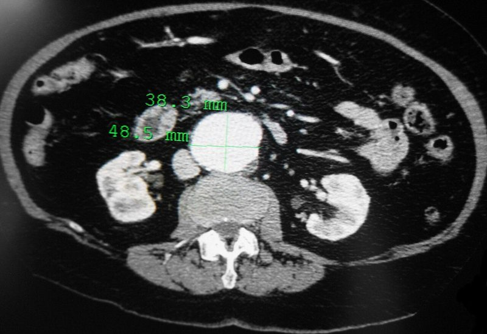

# Abdominal aortic diameter
Region: Abdomen
Keywords: AAA, abdominal aortic aneurysm, aneurysm screening, ultrasound, aneurisma de aorta abdominal

Diameter of the abdominal aorta on ultrasound or CT.

## How to measure

- Measure the greatest anteroposterior diameter perpendicular to the long axis of the aorta (on CT use a reformat perpendicular to the centreline when the aorta is tortuous).
- Say which edges were used: outer to outer is usual on CT; ultrasound screening programmes differ (inner to inner, or leading edge to leading edge).

## Values

| Finding | Infrarenal diameter |
|---|---|
| Normal | < 3.0 cm |
| Aneurysm | ≥ 3.0 cm, or more than 1.5 times the normal segment |
| Threshold for elective repair | ≥ 5.5 cm in men, ≥ 5.0 cm in women |
| Rapid growth | > 1 cm per year |

## Source

Chaikof EL et al. The Society for Vascular Surgery practice guidelines on the care of patients with an abdominal aortic aneurysm. J Vasc Surg 2018;67:2–77.

Picture: "Contrast-enhanced CT scan demonstrating abdominal aortic aneurysm.jpg" by James Heilman, MD, CC BY-SA 3.0 / GFDL, https://commons.wikimedia.org/wiki/File:Contrast-enhanced_CT_scan_demonstrating_abdominal_aortic_aneurysm.jpg (resized).
