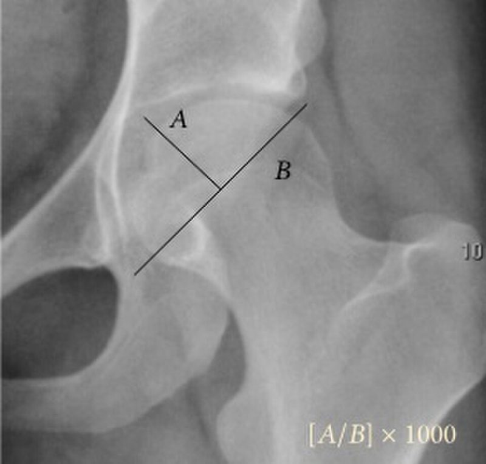

# Acetabular depth-to-width ratio
Region: Hip
Keywords: acetabular depth ratio, ADR, shallow acetabulum, dysplasia, profundidad acetabular

How deep the acetabulum is for its width, on an AP pelvis radiograph.

## How to measure

- B (width): line from the lower end of the teardrop to the lateral edge of the acetabular roof.
- A (depth): perpendicular from that line to the deepest point of the acetabular roof.
- Ratio = A / B × 1000.

## Values

| Finding | Ratio |
|---|---|
| Normal | > 250 |
| Shallow (dysplastic) acetabulum | < 250 |

## Source

Cooperman DR, Wallensten R, Stulberg SD. Acetabular dysplasia in the adult. Clin Orthop 1983;175:79–85.

Picture: "Acetabular depth ratio.jpg" by Ruiz Santiago F, Santiago Chinchilla A, Ansari A, Guzmán Álvarez L, Castellano García MM, Martínez Martínez A, Tercedor Sánchez J (Radiol Res Pract 2016, doi:10.1155/2016/6369237); uploaded by Mikael Häggström, CC BY 4.0, https://commons.wikimedia.org/wiki/File:Acetabular_depth_ratio.jpg (resized).
