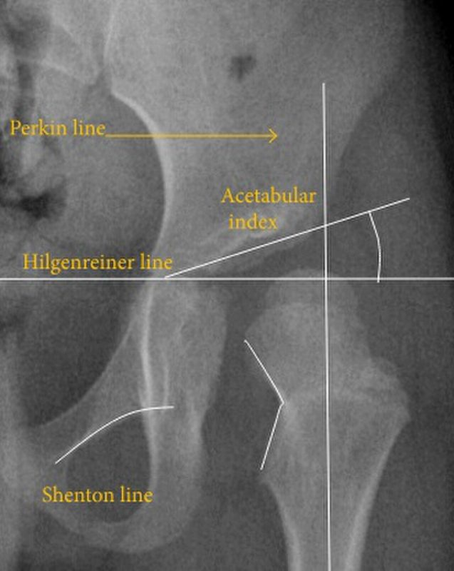

# Acetabular index, Hilgenreiner, Perkin and Shenton lines
Region: Hip
Keywords: DDH, developmental dysplasia, acetabular angle, AC angle, Ombredanne, Shenton arc, Ménard, displasia de cadera, índice acetabular

Slope of the acetabular roof and position of the femoral head in the child's hip, on an AP pelvis radiograph.

## How to measure

- Hilgenreiner line: horizontal line through the top of both triradiate cartilages.
- Perkin (Ombrédanne) line: perpendicular to it through the lateral edge of the acetabular roof.
- Acetabular index: angle between Hilgenreiner line and a line from the triradiate cartilage to the lateral edge of the roof.
- The ossific nucleus of the femoral head (or the medial metaphyseal beak before it ossifies) should lie in the inferomedial quadrant made by the two lines.
- Shenton line: the arc along the inferior border of the superior pubic ramus continues smoothly along the medial border of the femoral neck.

## Values

| Age | Acetabular index, upper limit |
|---|---|
| Newborn | about 30° |
| 1 year | about 25° |
| 2 years and older | about 20° |

Limits depend on age and sex (Tönnis tables); above them the roof is dysplastic. A head outside the inferomedial quadrant is subluxed or dislocated. A broken Shenton line means the femur is displaced upwards (also in femoral neck fractures in adults).

## Source

Hilgenreiner H. Med Klin 1925;21:1385–1388. Tönnis D. Normal values of the hip joint for the evaluation of X-rays in children and adults. Clin Orthop 1976;119:39–47.

Picture: "X-ray of measurements in hip dysplasia.jpg" by Ruiz Santiago F, Santiago Chinchilla A, Ansari A, Guzmán Álvarez L, Castellano García MM, Martínez Martínez A, Tercedor Sánchez J (Radiol Res Pract 2016, doi:10.1155/2016/6369237); uploaded by Mikael Häggström, CC BY 4.0, https://commons.wikimedia.org/wiki/File:X-ray_of_measurements_in_hip_dysplasia.jpg (resized).
