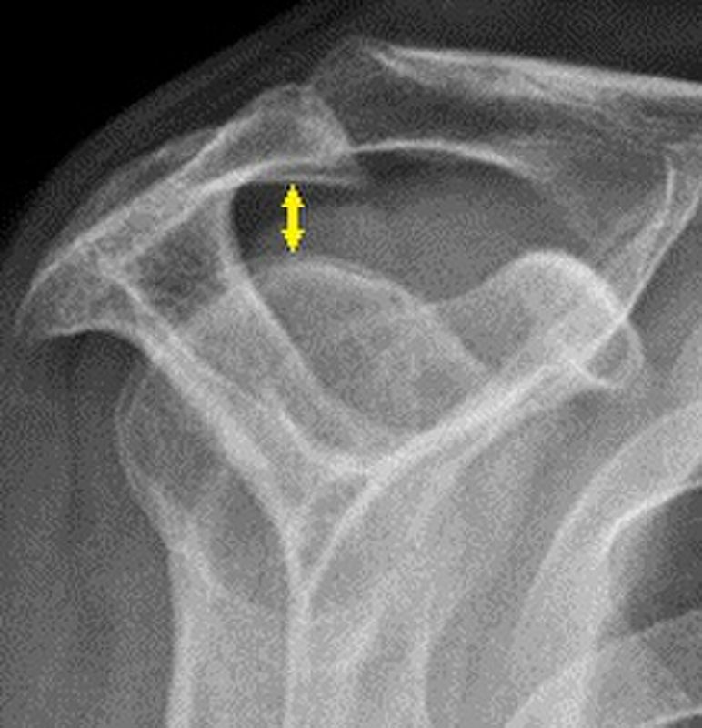

# Acromiohumeral distance
Region: Shoulder
Keywords: subacromial space, rotator cuff tear, cuff arthropathy, espacio subacromial, manguito rotador

Shortest distance between the acromion and the humeral head, on an AP radiograph of the shoulder (also outlet view, MRI or ultrasound).

## How to measure

- Measure from the dense cortex of the undersurface of the acromion to the top of the humeral head, where they are closest.
- Upright patient, arm in neutral rotation.

## Values

| Finding | Distance on the AP radiograph |
|---|---|
| Normal | 7–14 mm |
| Suggests a full-thickness rotator cuff tear | < 7 mm |
| Massive tear, often not repairable | < 5 mm |

## Source

Weiner DS, Macnab I. Superior migration of the humeral head. J Bone Joint Surg Br 1970;52:524–527. Saupe N et al. Association between rotator cuff abnormalities and reduced acromiohumeral distance. AJR 2006;187:376–382.

Picture: "Subacromial space on outlet view X-ray.jpg" by Han Y, Lee J, Park S, Suh E; annotated by Mikael Häggström, CC BY 4.0, https://commons.wikimedia.org/wiki/File:Subacromial_space_on_outlet_view_X-ray.jpg (resized).
