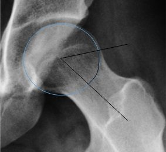

# Alpha angle
Region: Hip
Keywords: cam, femoroacetabular impingement, FAI, head-neck offset, pinzamiento femoroacetabular, ángulo alfa

Asphericity of the femoral head–neck junction (cam morphology); Dunn or cross-table lateral radiograph, or oblique axial / radial MRI or CT.

## How to measure

- Fit a circle to the femoral head.
- Draw the axis of the femoral neck from the centre of the circle through the middle of the neck.
- Draw a line from the centre to the point where the anterior contour of the head–neck junction first leaves the circle.
- The angle between the two lines is the alpha angle.

## Values

| Finding | Angle |
|---|---|
| Normal | < 50–55° |
| Cam morphology | > 55° (thresholds of 50–60° are in use) |

Cam morphology is common in people without symptoms: it is not a diagnosis of impingement by itself.

## Source

Nötzli HP et al. The contour of the femoral head-neck junction as a predictor for the risk of anterior impingement. J Bone Joint Surg Br 2002;84:556–560.

Picture: "Alpha angle measured in 45 degrees Dunn view.jpg" by Ruiz Santiago F, Santiago Chinchilla A, Ansari A, Guzmán Álvarez L, Castellano García MM, Martínez Martínez A, Tercedor Sánchez J (Radiol Res Pract 2016, doi:10.1155/2016/6369237); uploaded by Mikael Häggström, CC BY 4.0, https://commons.wikimedia.org/wiki/File:Alpha_angle_measured_in_45_degrees_Dunn_view.jpg (resized).
