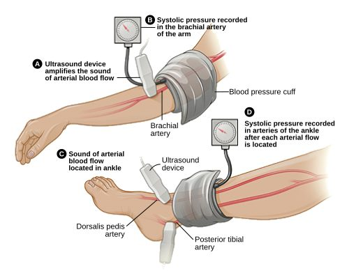

# Ankle–brachial index
Region: Vascular
Keywords: ABI, ABPI, peripheral arterial disease, PAD, Doppler, índice tobillo-brazo, ITB

Ratio of ankle to arm systolic pressure with a cuff and a continuous-wave Doppler probe; screening for peripheral arterial disease.

## How to measure

- Patient supine, rested for 5–10 minutes.
- Measure the systolic pressure in both brachial arteries and, in each leg, in the dorsalis pedis and posterior tibial arteries.
- ABI of a leg = higher of its two ankle pressures / higher of the two brachial pressures.

## Values

| ABI | Meaning |
|---|---|
| 1.00–1.40 | Normal |
| 0.91–0.99 | Borderline |
| ≤ 0.90 | Peripheral arterial disease |
| < 0.40 | Severe disease |
| > 1.40 | Arteries that cannot be compressed (diabetes, renal failure): use the toe–brachial index |

## Source

Aboyans V et al. Measurement and interpretation of the ankle-brachial index: a scientific statement from the American Heart Association. Circulation 2012;126:2890–2909.

Picture: "Pad abi ENG.svg" by Jmarchn, CC BY-SA 3.0, https://commons.wikimedia.org/wiki/File:Pad_abi_ENG.svg (resized).
