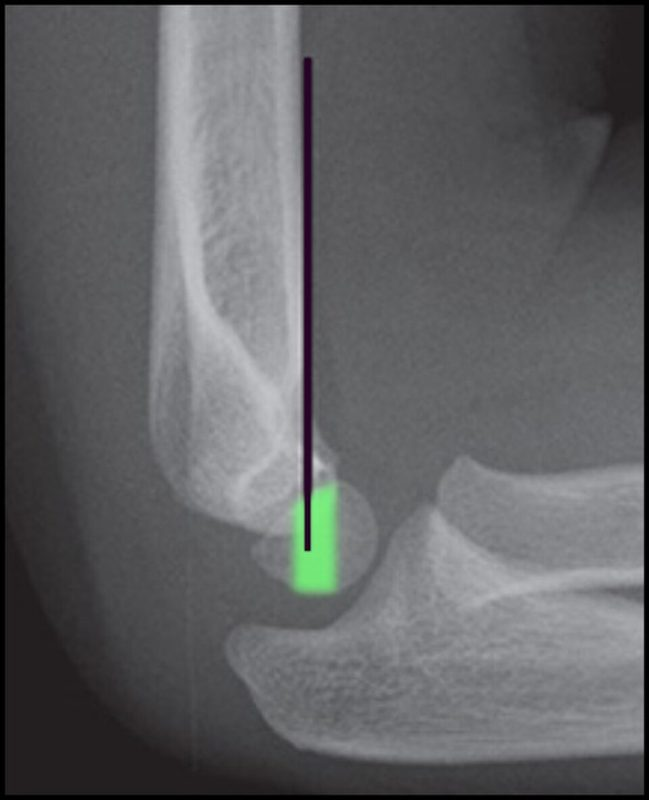

# Anterior humeral line
Region: Elbow
Keywords: supracondylar fracture, capitellum, capitulum, paediatric elbow, fractura supracondílea, línea humeral anterior

Line that shows posterior displacement of the distal humerus on a true lateral radiograph of a child's elbow.

## How to measure

- Draw a line along the anterior cortex of the humerus and extend it through the elbow.
- See which third of the capitellum it crosses.

## Values

| Finding | Meaning |
|---|---|
| Line through the middle third of the capitellum | Normal (from about 4 years of age) |
| Line through the anterior third, or in front of the capitellum | Extension-type supracondylar fracture |

Below 4 years the line may cross the anterior third in a normal elbow. Look for a posterior fat pad as well.

## Source

Herman MJ et al. Relationship of the anterior humeral line to the capitellar ossific nucleus. J Bone Joint Surg Am 2009;91:2188–2193.

Picture: "Anterior humeral line.jpg" by Kilborn T, Moodley H, Mears S (S Afr J Radiol 2015); annotated by Mikael Häggström, CC BY-SA 4.0, https://commons.wikimedia.org/wiki/File:Anterior_humeral_line.jpg (resized).
