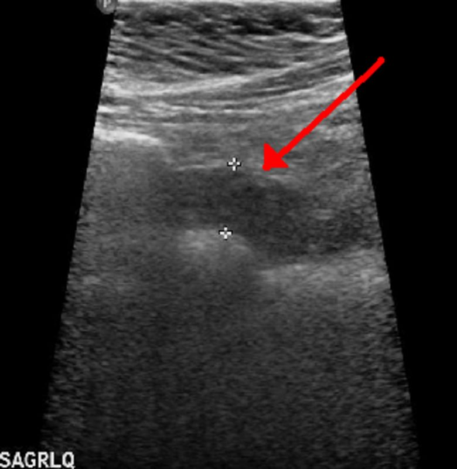

# Appendix diameter
Region: Abdomen
Keywords: appendicitis, graded compression, right lower quadrant, apendicitis, apéndice

Outer diameter of the appendix on graded-compression ultrasound (also CT).

## How to measure

- Find the blind-ending tubular structure that arises from the caecum and has no peristalsis.
- Measure outer wall to outer wall, across the appendix, while compressing.

## Values

| Finding | Meaning |
|---|---|
| ≤ 6 mm, compressible | Normal |
| > 6 mm, not compressible | Suggests appendicitis |
| Wall > 3 mm, appendicolith, hyperaemia, inflamed fat, fluid | Supporting signs |

On CT a diameter of 6–10 mm without other signs is indeterminate: a normal appendix filled with air or stool can exceed 6 mm.

## Source

Puylaert JB. Acute appendicitis: US evaluation using graded compression. Radiology 1986;158:355–360.

Picture: "Appendicities1.2cmdia.PNG" by James Heilman, MD, CC BY-SA 3.0, https://commons.wikimedia.org/wiki/File:Appendicities1.2cmdia.PNG (resized).
