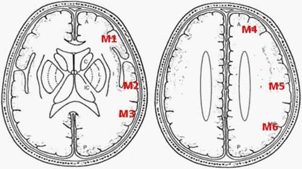

# ASPECTS (Alberta Stroke Program Early CT Score)
Region: Brain
Keywords: stroke, ischaemia, middle cerebral artery, MCA, thrombectomy, ictus, infarto

Extent of early ischaemic change in the middle cerebral artery territory on non-contrast CT.

## How to measure

- Look at two levels: the basal ganglia and thalamus, and just above them (supraganglionic).
- Start from 10 and subtract 1 for each region with early ischaemic change (loss of grey–white contrast, hypodensity, swelling).
- Ganglionic level: caudate (C), lentiform nucleus (L), internal capsule (IC), insula (I), M1, M2, M3.
- Supraganglionic level: M4, M5, M6.

## Values

| Score | Meaning |
|---|---|
| 10 | Normal CT |
| 8–10 | Small core |
| ≤ 7 | Higher risk of poor outcome and haemorrhage after thrombolysis |
| ≥ 6 | Inclusion threshold of the first thrombectomy trials |
| 0 | Whole territory involved |

## Source

Barber PA et al. Validity and reliability of a quantitative computed tomography score in predicting outcome of hyperacute stroke before thrombolytic therapy. Lancet 2000;355:1670–1674.

Picture: "Cerebral regions by ASPECTS.png" by Shazia Mirza and Sankalp Gokhale, CC BY 4.0, https://commons.wikimedia.org/wiki/File:Cerebral_regions_by_ASPECTS.png (resized).
