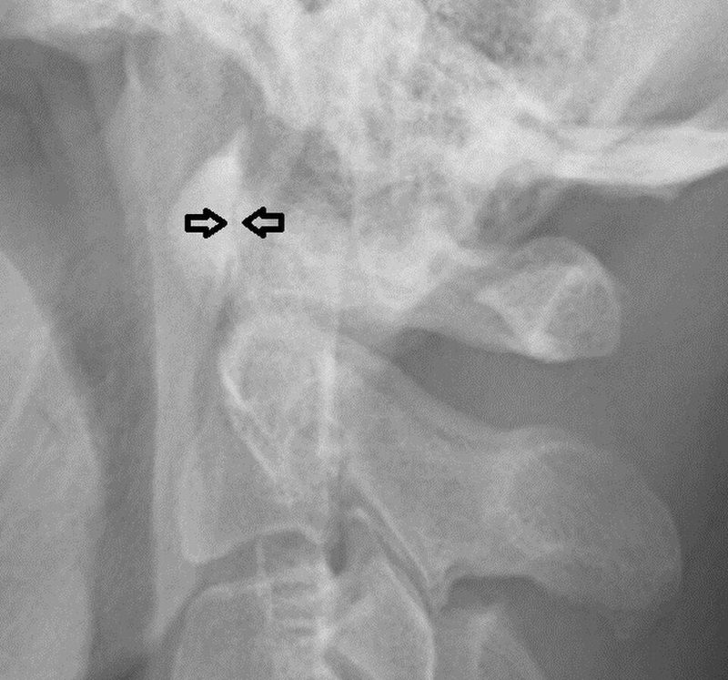

# Atlantodental interval (ADI)
Region: Spine
Keywords: atlantoaxial, predental space, C1 C2, instability, transverse ligament, rheumatoid, intervalo atlantoaxoideo

Distance between the anterior arch of the atlas and the dens, on a lateral cervical radiograph or a midsagittal CT.

## How to measure

- Measure from the posterior cortex of the anterior arch of C1 to the anterior cortex of the dens, at the middle or lower part of the joint.
- Flexion and extension views show instability that a neutral view hides.

## Values

| Patient | Upper limit |
|---|---|
| Adult | 3 mm |
| Child | 5 mm |

A wider interval suggests atlantoaxial instability (transverse ligament injury or laxity).

## Source

Hinck VC, Hopkins CE. Measurement of the atlanto-dental interval in the adult. AJR 1960;84:945–951. Locke GR et al. Atlas-dens interval in children. AJR 1966;97:135–140.

Picture: "Atlanto-dental joint.jpg" by Stillwaterising; derivative by Mikael Häggström, CC0 1.0, https://commons.wikimedia.org/wiki/File:Atlanto-dental_joint.jpg (resized).
