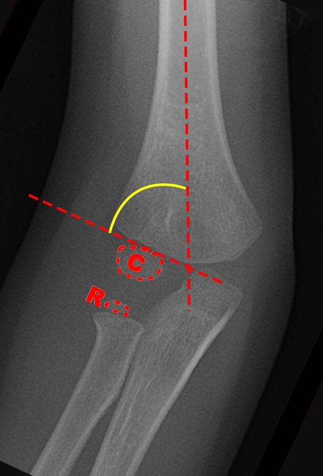

# Baumann angle
Region: Elbow
Keywords: humerocapitellar angle, supracondylar fracture, cubitus varus, carrying angle, fractura supracondílea

Coronal alignment of the distal humerus in a child, on an AP radiograph of the elbow.

## How to measure

- Draw the long axis of the humeral shaft.
- Draw a line along the physis of the lateral condyle (capitellum).
- Baumann angle is the angle between them.

## Values

| Finding | Angle |
|---|---|
| Normal | 64–81° (average about 72°) |
| After reduction of a supracondylar fracture | Within 5° of the other elbow |

A larger angle than the other side means varus. Rotation of the humerus changes the value.

## Source

Williamson DM et al. Normal characteristics of the Baumann (humerocapitellar) angle. J Pediatr Orthop 1992;12:636–639.

Picture: "Baumann's Angle.jpg" by Benoudina Samir, CC BY-SA 4.0, https://commons.wikimedia.org/wiki/File:Baumann's_Angle.jpg (resized).
