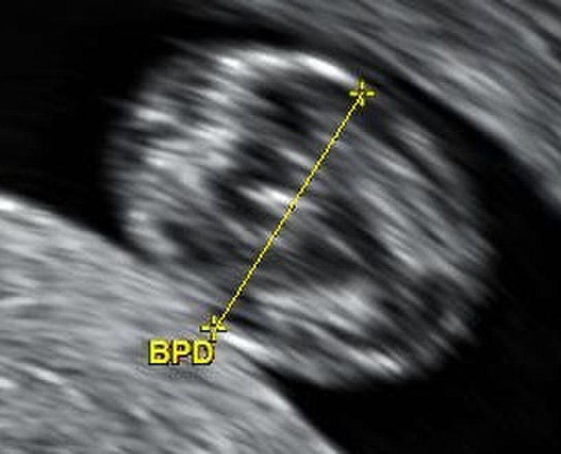

# Biparietal diameter
Region: Obstetrics
Keywords: BPD, fetal biometry, fetal head, gestational age, diámetro biparietal, DBP, biometría fetal

Width of the fetal head; part of fetal biometry from the end of the first trimester.

## How to measure

- Axial plane of the head with the thalami and the cavum septi pellucidi, a midline falx and a symmetrical oval skull; the cerebellum must not be in the image.
- Measure at the widest part, perpendicular to the midline.
- Caliper placement follows the reference chart: outer edge of the near skull to inner edge of the far skull (Hadlock), or outer to outer (INTERGROWTH-21st).

## Values

| Gestational age | BPD, about (50th centile) |
|---|---|
| 14 weeks | 27 mm |
| 20 weeks | 47 mm |
| 28 weeks | 71 mm |
| 36 weeks | 89 mm |

Use the chart of your unit for centiles. A long narrow or a round head makes BPD misleading: use head circumference.

## Source

Hadlock FP et al. Fetal biparietal diameter: a critical re-evaluation of the relation to menstrual age by means of real-time ultrasound. J Ultrasound Med 1982;1:97–104. Salomon LJ et al. ISUOG practice guidelines: ultrasound assessment of fetal biometry and growth. Ultrasound Obstet Gynecol 2019;53:715–723.

Picture: "Biparietal diameter.jpg" by Mikael Häggström, CC0 1.0, https://commons.wikimedia.org/wiki/File:Biparietal_diameter.jpg (resized).
