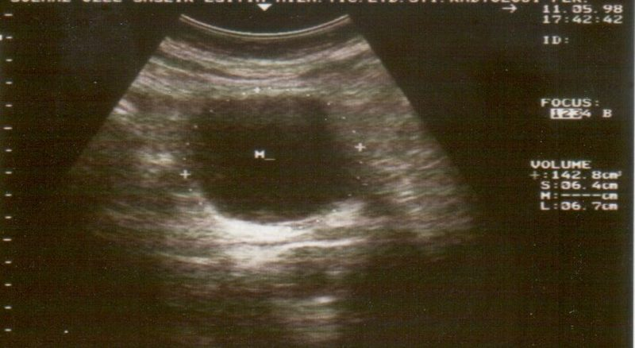

# Bladder volume and post-void residual
Region: Abdomen
Keywords: PVR, residual urine, urinary retention, ellipsoid formula, residuo posmiccional, vejiga

Volume of urine in the bladder on transabdominal ultrasound, before or after voiding.

## How to measure

- Transverse image: greatest width and anteroposterior depth. Sagittal image: greatest length.
- Volume (ml) = length × width × depth (cm) × 0.52 (ellipsoid). Machines and authors use factors from 0.52 to 0.72 depending on bladder shape.
- Measure the residual within a few minutes of voiding.

## Values

| Post-void residual in adults | Meaning |
|---|---|
| < 50 ml | Normal |
| 50–100 ml | Usually accepted, more so in the elderly |
| > 100–200 ml | Incomplete emptying |
| > 300 ml | Chronic retention |

Children: a residual above about 20 ml or 10 % of the expected capacity on repeated measurements is raised.

## Source

Dicuio M et al. Measurements of urinary bladder volume: comparison of five ultrasound calculation methods in volunteers. Arch Ital Urol Androl 2005;77:60–62. Kaplan SA et al. AUA white paper on nonneurogenic chronic urinary retention. J Urol 2017;198:153–160.

Picture: "Ultrasound Scan ND 024.jpg" by Nevit Dilmen, CC BY-SA 2.5 / CC BY-SA 3.0 / GFDL, https://commons.wikimedia.org/wiki/File:Ultrasound_Scan_ND_024.jpg (resized).
