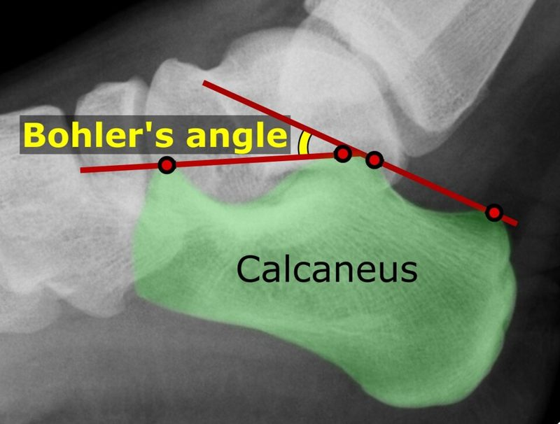

# Böhler angle
Region: Foot and ankle
Keywords: Boehler, tuber joint angle, calcaneus fracture, calcáneo, ángulo de Böhler

Height of the posterior facet of the calcaneus on a lateral radiograph of the foot; falls in intra-articular fractures.

## How to measure

- First line: highest point of the anterior process to the highest point of the posterior facet.
- Second line: highest point of the posterior facet to the highest point of the tuberosity.
- Böhler angle is the acute angle between them.

## Values

| Finding | Angle |
|---|---|
| Normal | 20–40° |
| Calcaneal fracture with depressed posterior facet | < 20° |

A normal angle does not exclude a fracture. Compare with the other foot when in doubt.

## Source

Böhler L. Diagnosis, pathology, and treatment of fractures of the os calcis. J Bone Joint Surg 1931;13:75–89.

Picture: "Bohler's angle (raster).jpg" by Mikael Häggström; source radiograph by Nevit Dilmen, CC BY-SA 3.0, https://commons.wikimedia.org/wiki/File:Bohler's_angle_(raster).jpg (resized).
