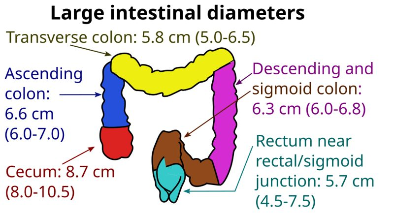

# Bowel diameter (3-6-9 rule)
Region: Abdomen
Keywords: bowel obstruction, dilatation, small bowel, colon, caecum, toxic megacolon, obstrucción intestinal, íleo

Upper limits of bowel calibre on an abdominal radiograph or CT.

## How to measure

- Measure the greatest diameter across the loop, outer wall to outer wall, perpendicular to its long axis.

## Values

| Segment | Upper limit |
|---|---|
| Small bowel | 3 cm |
| Colon | 6 cm |
| Caecum | 9 cm |

A caecum above 10–12 cm is at risk of perforation; a transverse colon above 6 cm in severe colitis suggests toxic megacolon. The picture gives average normal inner diameters, which are smaller than these limits.

## Source

Jaffe T, Thompson WM. Large-bowel obstruction in the adult: classic radiographic and CT findings, etiology, and mimics. Radiology 2015;275:651–663.

Picture: "Diameters of the large intestine.svg" by Mikael Häggström, CC0 1.0, https://commons.wikimedia.org/wiki/File:Diameters_of_the_large_intestine.svg (resized).
