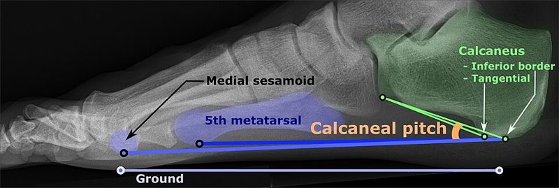

# Calcaneal pitch (calcaneal inclination angle)
Region: Foot and ankle
Keywords: pes planus, flatfoot, pes cavus, longitudinal arch, pie plano, pie cavo, inclinación del calcáneo

Height of the hindfoot part of the longitudinal arch on a weight-bearing lateral radiograph of the foot.

## How to measure

- Calcaneal line: along the inferior border of the calcaneus (tangent to its lowest points front and back).
- Reference: the supporting surface, or the line from the lowest point of the calcaneus to the lowest point of the fifth metatarsal head.
- The angle between them is the calcaneal pitch; say which reference was used.

## Values

| Finding | Angle |
|---|---|
| Low arch (pes planus) | < 18° |
| Normal | 18–30° |
| High arch (pes cavus) | > 30° |

## Source

Younger AS, Sawatzky B, Dryden P. Radiographic assessment of adult flatfoot. Foot Ankle Int 2005;26:820–825.

Picture: "Calcaneal pitch.jpg" by Mikael Häggström, CC0 1.0, https://commons.wikimedia.org/wiki/File:Calcaneal_pitch.jpg (resized).
