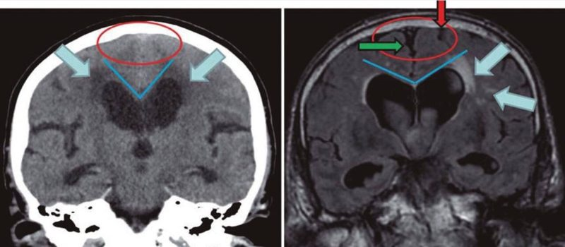

# Callosal angle
Region: Brain
Keywords: normal pressure hydrocephalus, NPH, iNPH, ventriculomegaly, atrophy, hidrocefalia normotensiva, ángulo calloso

Angle between the lateral ventricles on a coronal image; separates normal pressure hydrocephalus from atrophy.

## How to measure

- Coronal plane perpendicular to the line through the anterior and posterior commissures, at the level of the posterior commissure.
- Draw a line along the medial wall (roof) of each lateral ventricle; the angle between them is the callosal angle.

## Values

| Finding | Angle |
|---|---|
| Idiopathic normal pressure hydrocephalus | < 90° (typically 50–80°) |
| Atrophy (ex vacuo ventriculomegaly), healthy elderly | > 90° (typically 100–120°) |

A wrong plane changes the angle by tens of degrees.

## Source

Ishii K et al. Clinical impact of the callosal angle in the diagnosis of idiopathic normal pressure hydrocephalus. Eur Radiol 2008;18:2678–2683.

Picture: "Normal pressure hydrocephalus versus atrophy.jpg" by Benito Pereira Damasceno, CC BY 4.0, https://commons.wikimedia.org/wiki/File:Normal_pressure_hydrocephalus_versus_atrophy.jpg (resized).
