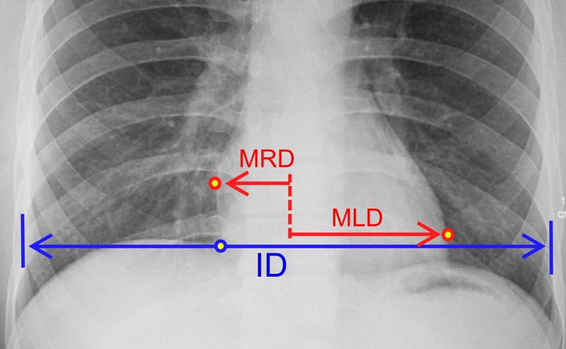

# Cardiothoracic ratio
Region: Chest
Keywords: CTR, cardiomegaly, heart size, índice cardiotorácico, cardiomegalia

Width of the heart relative to the chest on an erect PA chest radiograph in full inspiration.

## How to measure

- Draw a vertical midline through the spinous processes.
- MRD: greatest distance from the midline to the right heart border. MLD: greatest distance to the left heart border.
- ID: greatest internal width of the chest, inner rib margin to inner rib margin, usually at the level of the right hemidiaphragm.
- Ratio = (MRD + MLD) / ID.

## Values

| Finding | Ratio |
|---|---|
| Normal adult, PA erect | < 0.5 |
| Cardiomegaly | > 0.5 |
| Newborn, upper limit | about 0.6 |

AP and supine images magnify the heart, and so do poor inspiration and pectus excavatum: the 0.5 limit does not apply to them.

## Source

Danzer CS. The cardiothoracic ratio: an index of cardiac enlargement. Am J Med Sci 1919;157:513–521.

Picture: "Cardiothoracic ratio.jpg" by Mikael Häggström, CC0 1.0, https://commons.wikimedia.org/wiki/File:Cardiothoracic_ratio.jpg (resized).
