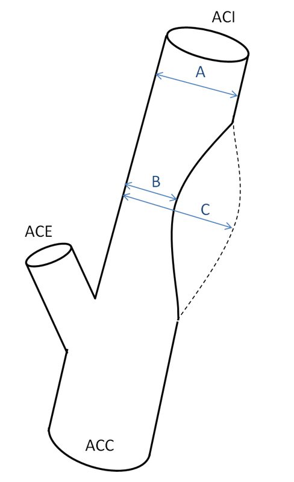

# Carotid stenosis (NASCET and ECST)
Region: Head and neck
Keywords: internal carotid artery, ICA, stenosis grading, endarterectomy, CTA, angiography, estenosis carotídea

Degree of internal carotid artery stenosis on angiography, CTA or MRA.

## How to measure

- B: narrowest residual lumen at the stenosis.
- A: diameter of the normal internal carotid artery beyond the bulb, where its walls are parallel.
- C: estimated original diameter of the artery at the stenosis.
- NASCET = (A − B) / A × 100. ECST = (C − B) / C × 100.

## Values

| NASCET | Grade |
|---|---|
| < 50 % | Mild |
| 50–69 % | Moderate |
| 70–99 % | Severe |
| No lumen | Occlusion |

ECST gives a higher figure for the same lesion (70 % NASCET is about 85 % ECST). Near-occlusion collapses the distal artery, and NASCET then underestimates.

## Source

NASCET Collaborators. Beneficial effect of carotid endarterectomy in symptomatic patients with high-grade carotid stenosis. N Engl J Med 1991;325:445–453. European Carotid Surgery Trialists. Lancet 1998;351:1379–1387.

Picture: "NASCET and ECST.png" by Mme Mim, CC BY-SA 3.0, https://commons.wikimedia.org/wiki/File:NASCET_and_ECST.png (resized).
