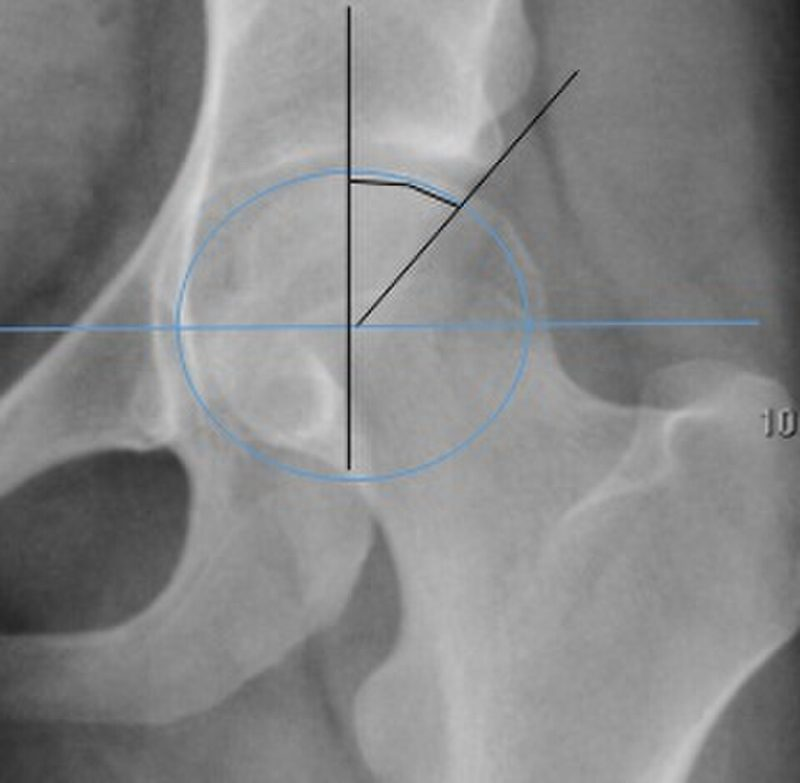

# Lateral centre-edge angle (Wiberg)
Region: Hip
Keywords: CE angle, LCEA, dysplasia, pincer, overcoverage, coverage, ángulo centro-borde

Lateral coverage of the femoral head by the acetabulum, on an AP pelvis radiograph.

## How to measure

- Fit a circle to the femoral head and mark its centre.
- Draw a vertical line through the centre, perpendicular to the line joining both teardrops or both ischial tuberosities.
- Draw a line from the centre to the lateral edge of the sourcil (the weight-bearing sclerotic roof).
- The angle between the two is the centre-edge angle.

## Values

| Adult | Angle |
|---|---|
| Dysplasia | < 20° |
| Borderline | 20–25° |
| Normal | 25–39° |
| Overcoverage (pincer) | ≥ 40° |

## Source

Wiberg G. Studies on dysplastic acetabula and congenital subluxation of the hip joint. Acta Chir Scand 1939;83 Suppl 58.

Picture: "Center-edge angle of Wiberg.jpg" by Ruiz Santiago F, Santiago Chinchilla A, Ansari A, Guzmán Álvarez L, Castellano García MM, Martínez Martínez A, Tercedor Sánchez J (Radiol Res Pract 2016, doi:10.1155/2016/6369237); uploaded by Mikael Häggström, CC BY 4.0, https://commons.wikimedia.org/wiki/File:Center-edge_angle_of_Wiberg.jpg (resized).
