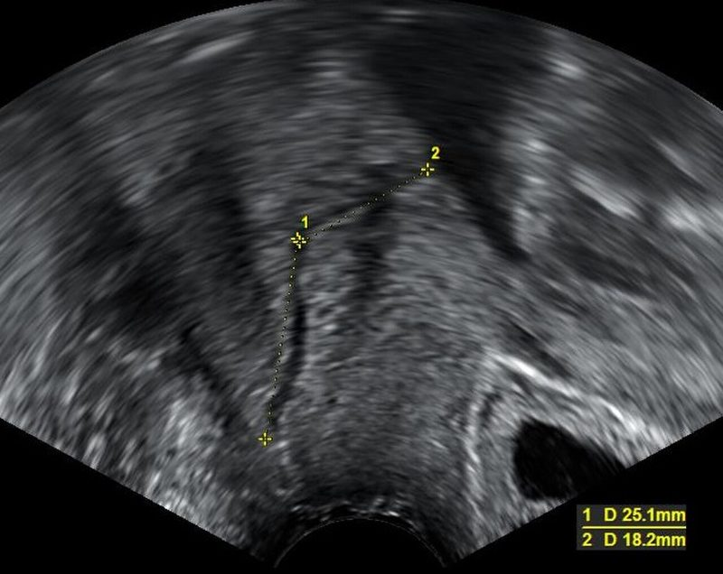

# Cervical length
Region: Obstetrics
Keywords: short cervix, preterm birth, funnelling, transvaginal, longitud cervical, parto pretérmino

Length of the closed cervix on transvaginal ultrasound in pregnancy.

## How to measure

- Empty bladder; probe in the anterior fornix with as little pressure as possible.
- Sagittal image showing the internal os, the external os and the whole canal; the cervix fills at least half of the screen.
- Measure along the canal from the internal to the external os; when the canal is curved add two straight segments.
- Watch for 3–5 minutes and report the shortest of three measurements.

## Values

| Finding before 24 weeks | Length |
|---|---|
| Normal | > 25 mm (average 35–40 mm) |
| Short cervix | ≤ 25 mm |
| High risk of preterm birth | < 15 mm |

## Source

Iams JD et al. The length of the cervix and the risk of spontaneous premature delivery. N Engl J Med 1996;334:567–572. Kagan KO, Sonek J. How to measure cervical length. Ultrasound Obstet Gynecol 2015;45:358–362.

Picture: "Cervix length measurement.jpg" by Mikael Häggström, CC0 1.0, https://commons.wikimedia.org/wiki/File:Cervix_length_measurement.jpg (resized).
