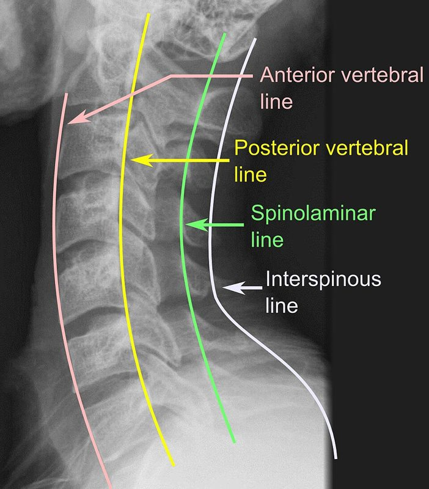

# Cervical vertebral lines
Region: Spine
Keywords: alignment, anterior vertebral line, posterior vertebral line, spinolaminar line, subluxation, trauma, líneas cervicales

Four lines that check the alignment of the cervical spine on a lateral radiograph or sagittal CT.

## How to measure

- Anterior vertebral line: along the front of the vertebral bodies.
- Posterior vertebral line: along the back of the vertebral bodies.
- Spinolaminar line: along the junctions of laminae and spinous processes.
- Interspinous (posterior spinous) line: along the tips of the spinous processes.
- The image must reach the C7–T1 junction.

## Values

| Finding | Meaning |
|---|---|
| Four smooth, unbroken lordotic curves | Normal alignment |
| Step or break of a line | Subluxation, dislocation or fracture until proven otherwise |
| Translation > 3.5 mm or angulation > 11° more than the adjacent level | Instability (White and Panjabi) |

In young children C2 on C3 (less often C3 on C4) may slip forward physiologically; the spinolaminar line of C1–C3 (Swischuk) stays within 2 mm.

## Source

White AA, Panjabi MM. Clinical biomechanics of the spine, 2nd ed., 1990. Swischuk LE. Anterior displacement of C2 in children. Radiology 1977;122:759–763.

Picture: "X-ray of vertebral lines.jpg" by Mikael Häggström, CC0 1.0, https://commons.wikimedia.org/wiki/File:X-ray_of_vertebral_lines.jpg (resized).
