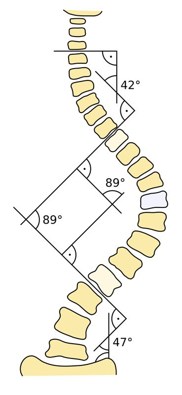

# Cobb angle
Region: Spine
Keywords: scoliosis, coronal curve, escoliosis, ángulo de Cobb, end vertebra

Size of a coronal spinal curve on a standing frontal radiograph of the whole spine.

## How to measure

- Find the end vertebrae: the most tilted vertebra at the top and at the bottom of the curve.
- Draw a line along the upper end plate of the upper end vertebra and one along the lower end plate of the lower end vertebra.
- The Cobb angle is the angle between the two lines (or between their perpendiculars, which is easier when the lines meet off the image).
- Use the same end vertebrae at follow-up.

## Values

| Finding | Cobb angle |
|---|---|
| Spinal asymmetry, not scoliosis | < 10° |
| Scoliosis | ≥ 10° |
| Mild | 10–25° |
| Moderate (bracing is considered while growing) | 25–45° |
| Severe (surgery is considered) | > 45–50° |

Measurement error is about ±5°: a change below that is not progression.

## Source

Cobb JR. Outline for the study of scoliosis. AAOS Instr Course Lect 1948;5:261–275. Scoliosis Research Society definitions.

Picture: "Scoliosis cobb.svg" by Skoliose-Info-Forum.de, CC BY-SA 3.0 (also GFDL 1.2+), https://commons.wikimedia.org/wiki/File:Scoliosis_cobb.svg (resized).
