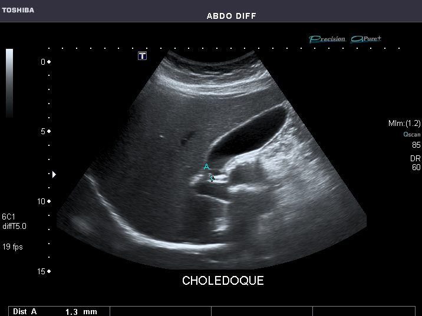

# Common bile duct diameter
Region: Abdomen
Keywords: CBD, common duct, biliary dilatation, choledocholithiasis, colédoco, vía biliar

Calibre of the extrahepatic bile duct on ultrasound (also CT, MRCP).

## How to measure

- Long axis of the duct at the porta hepatis, in front of the portal vein, where it crosses the right hepatic artery.
- Inner wall to inner wall, perpendicular to the duct.

## Values

| Patient | Upper limit |
|---|---|
| Adult up to 60 years | 6 mm |
| Older than 60 | 1 mm more per decade |
| After cholecystectomy | up to 10 mm |

## Source

Parulekar SG. Ultrasound evaluation of common bile duct size. Radiology 1979;133:703–707. Bowie JD. What is the upper limit of normal for the common bile duct on ultrasound: how much do you want it to be? Am J Gastroenterol 2000;95:897–900.

Picture: "Abdominal Ultrasound Full Exam 12.jpg" by Ptrump16, CC BY-SA 4.0, https://commons.wikimedia.org/wiki/File:Abdominal_Ultrasound_Full_Exam_12.jpg (resized).
