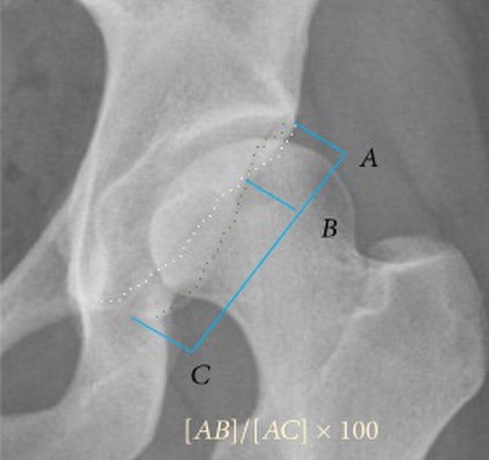

# Crossover sign and crossing ratio
Region: Hip
Keywords: acetabular retroversion, figure of eight, pincer, femoroacetabular impingement, retroversión acetabular

Sign of cranial acetabular retroversion on a well-centred AP pelvis radiograph.

## How to measure

- Trace the anterior and the posterior acetabular walls from the lateral edge of the roof downwards.
- Normally the anterior wall stays medial to the posterior wall along its whole length.
- Crossover sign: the anterior wall starts lateral to the posterior wall and crosses it (figure of eight).
- Crossing ratio: distance from the lateral edge of the roof to the crossing point (AB) over the length of the acetabular opening (AC), × 100.

## Values

| Finding | Meaning |
|---|---|
| No crossing | Normal anteversion |
| Crossing | Cranial retroversion; the higher the ratio, the more of the acetabulum is retroverted |

Pelvic tilt and rotation produce false signs: the coccyx should point to the symphysis, with its tip about 1–3 cm above it.

## Source

Reynolds D, Lucas J, Klaue K. Retroversion of the acetabulum. J Bone Joint Surg Br 1999;81:281–288.

Picture: "Crossing ratio of the hip.jpg" by Ruiz Santiago F, Santiago Chinchilla A, Ansari A, Guzmán Álvarez L, Castellano García MM, Martínez Martínez A, Tercedor Sánchez J (Radiol Res Pract 2016, doi:10.1155/2016/6369237); uploaded by Mikael Häggström, CC BY 4.0, https://commons.wikimedia.org/wiki/File:Crossing_ratio_of_the_hip.jpg (resized).
