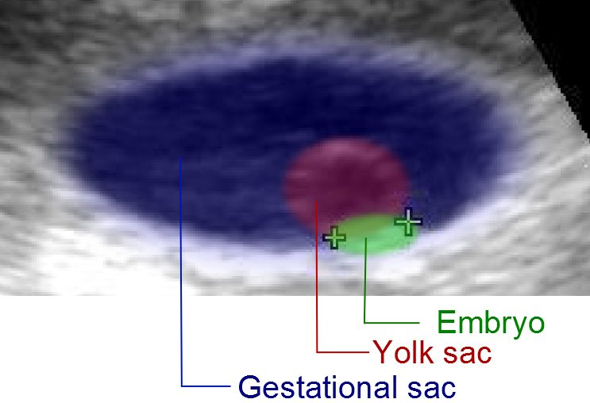

# Crown–rump length
Region: Obstetrics
Keywords: CRL, dating, gestational age, first trimester, longitud cráneo-caudal, LCC, edad gestacional

Length of the embryo or fetus; the most accurate dating of a pregnancy in the first trimester.

## How to measure

- Midsagittal image of the embryo or fetus in a neutral position (neither flexed nor extended), filling most of the screen.
- Measure the longest straight line from the top of the head to the rump. Leave out the yolk sac and the limbs.
- Take the mean of three good measurements.

## Values

| Finding | Meaning |
|---|---|
| Gestational age in weeks | about CRL in cm + 6.5 |
| CRL up to 84 mm (13 weeks 6 days) | Date by CRL; later use head circumference |
| CRL ≥ 7 mm without a heartbeat | Failed pregnancy |
| CRL < 7 mm without a heartbeat | Suspicious: repeat the scan in 7–14 days |

## Source

Robinson HP, Fleming JE. A critical evaluation of sonar crown-rump length measurements. Br J Obstet Gynaecol 1975;82:702–710. Doubilet PM et al. N Engl J Med 2013;369:1443–1451.

Picture: "Ultrasound of embryo at 5 weeks, colored.png" by X.Compagnion (original File:Embryo at 5 weeks.JPG); derivative by Mikael Häggström, CC BY 2.5 / CC BY-SA 3.0 / GFDL, https://commons.wikimedia.org/wiki/File:Ultrasound_of_embryo_at_5_weeks,_colored.png (resized).
