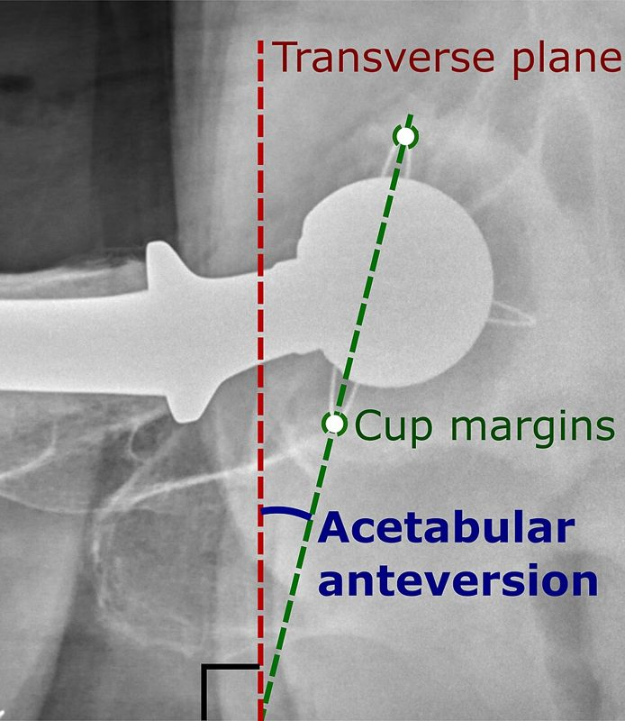

# Acetabular cup anteversion (hip prosthesis)
Region: Hip
Keywords: total hip arthroplasty, THA, cup position, Lewinnek safe zone, inclination, prótesis de cadera, anteversión

Anteversion of the acetabular component on a cross-table lateral radiograph.

## How to measure

- Draw a line through the two margins of the cup opening.
- Draw a line perpendicular to the table (the transverse plane seen on edge).
- The angle between them is the anteversion (Woo and Morrey).
- Cup inclination is measured on the AP view: opening line against the inter-teardrop or inter-ischial line.

## Values

Lewinnek safe zone:

| Measurement | Target |
|---|---|
| Anteversion | 15° ± 10° (5–25°) |
| Inclination | 40° ± 10° (30–50°) |

Pelvic tilt and hip flexion change the value on this view; CT is the reference when it matters.

## Source

Lewinnek GE et al. Dislocations after total hip-replacement arthroplasties. J Bone Joint Surg Am 1978;60:217–220. Woo RY, Morrey BF. J Bone Joint Surg Am 1982;64:1295–1306.

Picture: "Acetabular anteversion of hip prosthesis.jpg" by Mikael Häggström, CC0 1.0, https://commons.wikimedia.org/wiki/File:Acetabular_anteversion_of_hip_prosthesis.jpg (resized).
