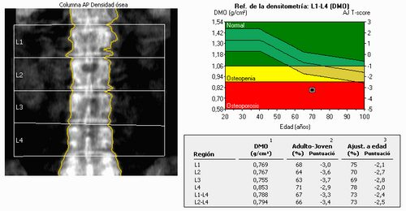

# Bone densitometry T-score and Z-score (DXA)
Region: Bone density
Keywords: DEXA, osteoporosis, osteopenia, bone mineral density, BMD, densitometría ósea

Bone mineral density by dual-energy X-ray absorptiometry of the lumbar spine (L1–L4) and the hip.

## How to measure

- T-score = (patient's BMD − mean BMD of young adults) / standard deviation of young adults.
- Z-score = the same against people of the same age and sex.
- Use the lowest T-score of lumbar spine, femoral neck and total hip. Leave out vertebrae with fractures or marked degenerative change (at least two must remain).

## Values

WHO classification, postmenopausal women and men of 50 or older:

| T-score | Category |
|---|---|
| ≥ −1.0 | Normal |
| between −1.0 and −2.5 | Low bone mass (osteopenia) |
| ≤ −2.5 | Osteoporosis |
| ≤ −2.5 with a fragility fracture | Severe osteoporosis |

Premenopausal women, men under 50 and children: use the Z-score; ≤ −2.0 is below the expected range for age.

## Source

WHO Study Group. Assessment of fracture risk and its application to screening for postmenopausal osteoporosis. WHO Technical Report Series 843, 1994. ISCD Official Positions, Adult, 2019.

Picture: "DXA lumbar column with osteoporosi.png" by Jmarchn, CC BY-SA 3.0, https://commons.wikimedia.org/wiki/File:DXA_lumbar_column_with_osteoporosi.png (resized).
