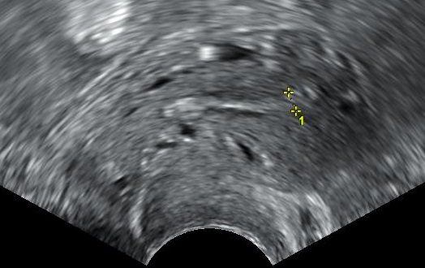

# Endometrial thickness
Region: Pelvis
Keywords: endometrium, postmenopausal bleeding, double layer, transvaginal, endometrio, sangrado posmenopáusico

Thickness of the endometrium on a transvaginal sagittal ultrasound image of the uterus.

## How to measure

- Sagittal plane showing the whole endometrial stripe up to the cervical canal.
- Measure both layers together (double layer) at the thickest point, perpendicular to the midline, from one basal interface to the other.
- Leave out fluid in the cavity (measure each layer and add them) and the dark inner myometrium.

## Values

| Situation | Thickness |
|---|---|
| Postmenopausal with bleeding | ≤ 4 mm: endometrial cancer very unlikely; > 4 mm: sample |
| Postmenopausal without bleeding | Up to 8–11 mm is commonly accepted |
| During menstruation | 2–4 mm |
| Proliferative phase | 5–7 mm (up to 11 mm before ovulation) |
| Secretory phase | 7–16 mm |

Hormone therapy and tamoxifen thicken the endometrium.

## Source

ACOG Committee Opinion 734. The role of transvaginal ultrasonography in evaluating the endometrium of women with postmenopausal bleeding. Obstet Gynecol 2018;131:e124–129. Smith-Bindman R et al. Ultrasound Obstet Gynecol 2004;24:558–565.

Picture: "Uterus of 88 year old female.jpg" by Mikael Häggström, CC0 1.0, https://commons.wikimedia.org/wiki/File:Uterus_of_88_year_old_female.jpg (resized).
