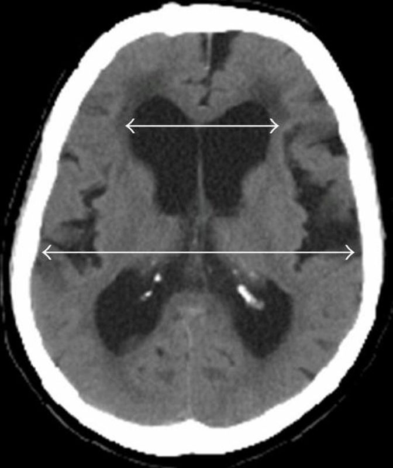

# Evans index
Region: Brain
Keywords: ventriculomegaly, hydrocephalus, normal pressure hydrocephalus, NPH, frontal horns, hidrocefalia, índice de Evans

Size of the lateral ventricles on an axial CT or MRI slice.

## How to measure

- Greatest width of the frontal horns of the lateral ventricles.
- Greatest inner width of the skull on the same slice.
- Evans index = frontal horn width / inner skull width.

## Values

| Finding | Index |
|---|---|
| Normal | < 0.3 |
| Ventriculomegaly | > 0.3 |

The index depends on the slice and its angle, and rises with age; it does not separate hydrocephalus from atrophy.

## Source

Evans WA. An encephalographic ratio for estimating ventricular enlargement and cerebral atrophy. Arch Neurol Psychiatry 1942;47:931–937.

Picture: "CT of Evan's index.jpg" by Mitsuaki Ishii, Toshio Kawamata, Ichiro Akiguchi, Hideo Yagi, Yuko Watanabe, Toshiyuki Watanabe, and Hideaki Mashimo, CC BY 3.0, https://commons.wikimedia.org/wiki/File:CT_of_Evan's_index.jpg (resized).
