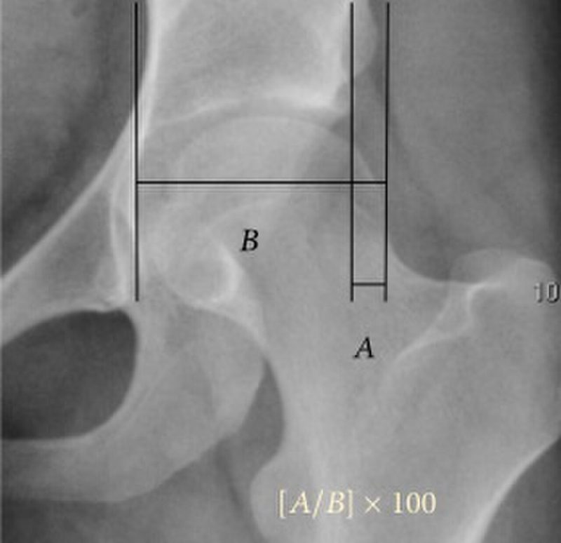

# Femoral head extrusion index
Region: Hip
Keywords: extrusion, uncovered head, dysplasia, coverage, índice de extrusión

Part of the femoral head not covered by the acetabulum in the adult; the adult counterpart of the migration percentage.

## How to measure

- On an AP pelvis radiograph draw vertical lines at the medial edge of the femoral head, at the lateral edge of the acetabulum and at the lateral edge of the femoral head.
- Index = width of head lateral to the acetabular edge / whole width of the head × 100.

## Values

| Finding | Index |
|---|---|
| Normal | < 25 % |
| Dysplasia, undercoverage | ≥ 25 % |

## Source

Heyman CH, Herndon CH. Legg-Perthes disease: a method for the measurement of the roentgenographic result. J Bone Joint Surg Am 1950;32:767–778.

Picture: "Femoral extrusion index.jpg" by Ruiz Santiago F, Santiago Chinchilla A, Ansari A, Guzmán Álvarez L, Castellano García MM, Martínez Martínez A, Tercedor Sánchez J (Radiol Res Pract 2016, doi:10.1155/2016/6369237); uploaded by Mikael Häggström, CC BY 4.0, https://commons.wikimedia.org/wiki/File:Femoral_extrusion_index.jpg (resized).
