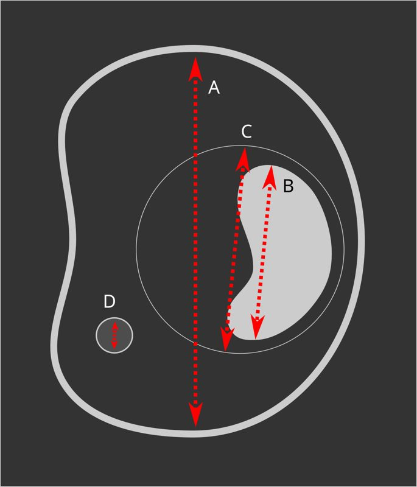

# Mean gestational sac diameter
Region: Obstetrics
Keywords: MSD, gestational sac, early pregnancy, yolk sac, pregnancy failure, saco gestacional

Size of the gestational sac in the first trimester on transvaginal ultrasound.

## How to measure

- Measure the inner diameter of the sac (fluid only, not the bright rim) in three perpendicular directions.
- Mean sac diameter (MSD) = (length + width + depth) / 3.

## Values

| Finding | Meaning |
|---|---|
| Gestational age in days | about MSD in mm + 30 |
| MSD ≥ 25 mm without an embryo | Failed pregnancy |
| MSD 16–24 mm without an embryo | Suspicious: repeat the scan in 7–14 days |

Once an embryo is seen, date the pregnancy by the crown–rump length.

## Source

Doubilet PM et al. Diagnostic criteria for nonviable pregnancy early in the first trimester. N Engl J Med 2013;369:1443–1451.

Picture: "Gestational sac.svg" by Nevit Dilmen, CC BY-SA 3.0 / GFDL, https://commons.wikimedia.org/wiki/File:Gestational_sac.svg (resized).
