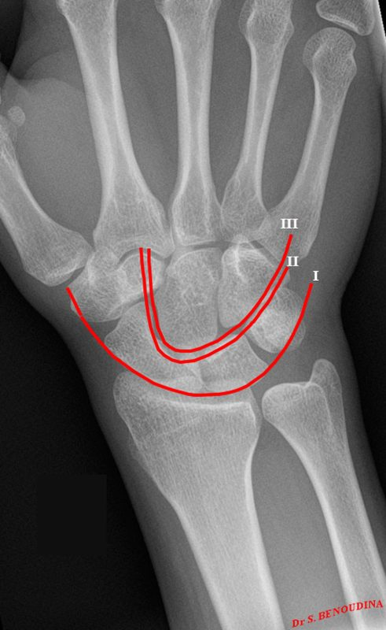

# Gilula carpal arcs
Region: Wrist
Keywords: carpal arcs, lunate dislocation, perilunate, carpal alignment, arcos de Gilula, luxación perilunar

Three smooth arcs that check carpal alignment on a PA radiograph of the wrist in neutral position.

## How to measure

- Arc I: proximal surfaces of scaphoid, lunate and triquetrum.
- Arc II: distal surfaces of the same three bones.
- Arc III: proximal surfaces of capitate and hamate.

## Values

| Finding | Meaning |
|---|---|
| Three smooth arcs, joint spaces about 2 mm | Normal |
| Step or break in an arc | Ligament tear, fracture or dislocation at that joint (perilunate, lunate) |

A small step at the lunotriquetral joint can be normal; radial or ulnar deviation distorts the arcs.

## Source

Gilula LA. Carpal injuries: analytic approach and case exercises. AJR 1979;133:503–517.

Picture: "Gilula1.jpg" by Benoudina Samir, CC BY-SA 4.0, https://commons.wikimedia.org/wiki/File:Gilula1.jpg (resized).
