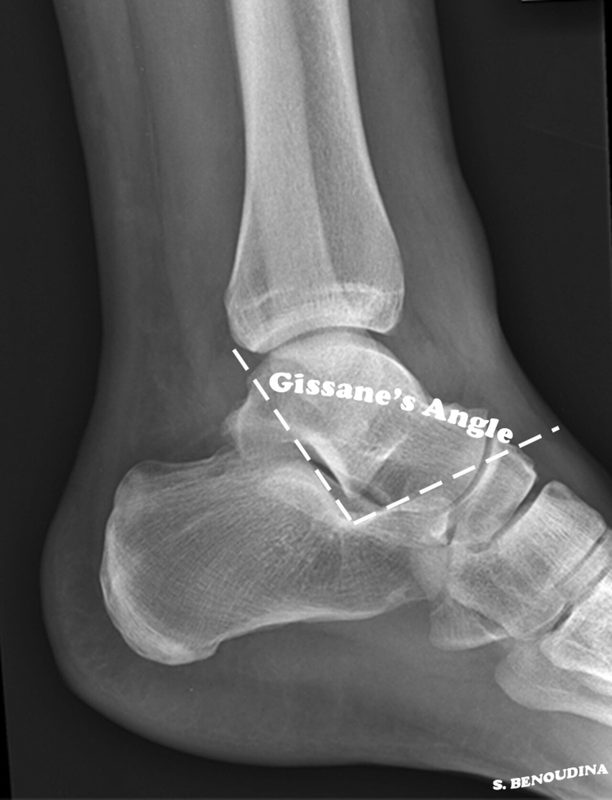

# Critical angle of Gissane
Region: Foot and ankle
Keywords: crucial angle, calcaneus fracture, calcáneo, ángulo de Gissane

Angle of the dense cortical struts under the lateral process of the talus, on a lateral radiograph of the foot.

## How to measure

- First line: along the downward slope of the posterior facet of the calcaneus.
- Second line: along the upward slope of the anterior process.
- The angle between them, open upwards, is the angle of Gissane.

## Values

| Finding | Angle |
|---|---|
| Normal | 120–145° |
| Intra-articular calcaneal fracture | > 145° |

## Source

Essex-Lopresti P. The mechanism, reduction technique, and results in fractures of the os calcis. Br J Surg 1952;39:395–419.

Picture: "Gissane.jpg" by Benoudina Samir, CC BY-SA 4.0, https://commons.wikimedia.org/wiki/File:Gissane.jpg (resized).
