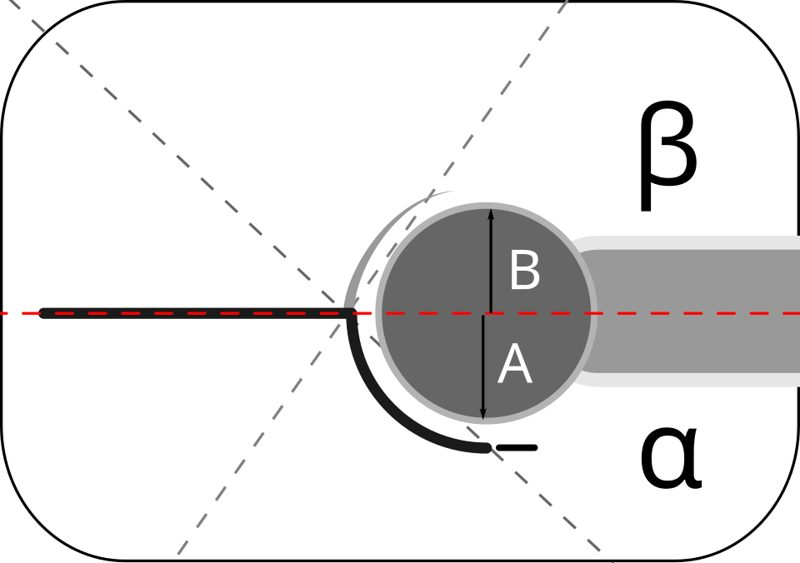

# Graf alpha and beta angles (infant hip ultrasound)
Region: Hip
Keywords: DDH, developmental dysplasia, sonography, ultrasound, bony roof, cartilage roof, femoral head coverage, ecografía de cadera

Maturity of the infant hip on a standard coronal ultrasound plane (straight iliac line, lower limb of the ilium, labrum).

## How to measure

- Baseline: along the straight lateral wall of the ilium.
- Bony roof line: from the lower limb of the ilium tangent to the bony acetabular roof. Alpha is its angle with the baseline.
- Cartilage roof line: from the bony rim through the centre of the labrum. Beta is its angle with the baseline.
- Femoral head coverage (Morin, Terjesen): part of the head medial to the baseline divided by its diameter.

## Values

| Graf type | Alpha | Beta | Meaning |
|---|---|---|---|
| I | ≥ 60° | < 55° (Ia), > 55° (Ib) | Mature hip |
| IIa | 50–59° | | Physiologically immature, younger than 3 months |
| IIb | 50–59° | | Delayed ossification, older than 3 months |
| IIc | 43–49° | < 77° | Critical range, still centred |
| D | 43–49° | > 77° | Decentring |
| III, IV | < 43° | | Dislocated |

Femoral head coverage: at least 50 % is normal.

## Source

Graf R. Fundamentals of sonographic diagnosis of infant hip dysplasia. J Pediatr Orthop 1984;4:735–740.

Picture: "Hip dysplasia ultrasound.svg" by Nevit Dilmen, CC BY-SA 3.0 (also GFDL 1.2+), https://commons.wikimedia.org/wiki/File:Hip_dysplasia_ultrasound.svg (resized).
