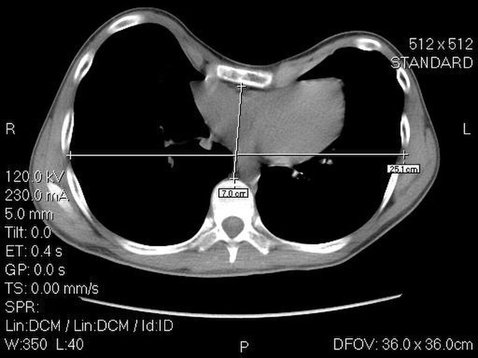

# Haller index
Region: Chest
Keywords: pectus excavatum, funnel chest, pectus index, tórax en embudo

Severity of pectus excavatum on an axial CT or MRI slice at the deepest point of the depression.

## How to measure

- Transverse diameter: greatest internal width of the chest on that slice.
- Anteroposterior distance: from the back of the sternum to the front of the vertebral body.
- Haller index = transverse diameter / anteroposterior distance.

## Values

| Finding | Index |
|---|---|
| Normal | about 2.5 |
| Severe pectus excavatum (surgery is considered) | > 3.25 |

## Source

Haller JA, Kramer SS, Lietman SA. Use of CT scans in selection of patients for pectus excavatum surgery. J Pediatr Surg 1987;22:904–906.

Picture: "Haller index PE.jpg" by Stepshep, CC BY-SA 3.0, https://commons.wikimedia.org/wiki/File:Haller_index_PE.jpg (resized).
