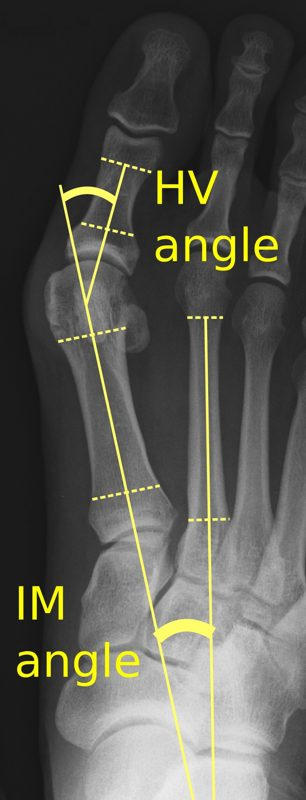

# Hallux valgus and intermetatarsal angles
Region: Foot and ankle
Keywords: HVA, IMA, bunion, metatarsus primus varus, juanete, ángulo intermetatarsiano

Severity of hallux valgus on a weight-bearing dorsoplantar radiograph of the foot.

## How to measure

- Draw the long axes of the first metatarsal, the proximal phalanx of the great toe and the second metatarsal, each through the midpoints of the shaft.
- Hallux valgus angle (HVA): first metatarsal against proximal phalanx.
- Intermetatarsal angle (IMA): first against second metatarsal.

## Values

| Severity | HVA | IMA |
|---|---|---|
| Normal | < 15° | < 9° |
| Mild | 15–30° | 9–13° |
| Moderate | 30–40° | 13–20° |
| Severe | > 40° | > 20° |

Non-weight-bearing images underestimate both angles.

## Source

Coughlin MJ, Saltzman CL, Nunley JA. Angular measurements in the evaluation of hallux valgus deformities. Foot Ankle Int 2002;23:68–74.

Picture: "HV and IM angles of hallux valgus.jpg" by Mikael Häggström; source radiograph by Michael Nebel, CC BY-SA 2.0 DE, https://commons.wikimedia.org/wiki/File:HV_and_IM_angles_of_hallux_valgus.jpg (resized).
