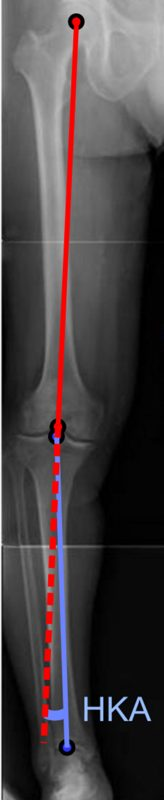

# Hip–knee–ankle angle (mechanical axis)
Region: Lower limb
Keywords: HKA, mechanical axis, varus, valgus, genu varum, genu valgum, alignment, eje mecánico, telemetría

Coronal alignment of the lower limb on a standing full-length radiograph, patella facing forward.

## How to measure

- Femoral mechanical axis: centre of the femoral head to the centre of the knee.
- Tibial mechanical axis: centre of the knee to the centre of the ankle (talus).
- HKA is the angle between the two axes.
- The weight-bearing line (centre of the femoral head to centre of the ankle) normally crosses the knee near its centre.

## Values

| Finding | HKA |
|---|---|
| Neutral | 180° ± 3° (healthy adults average about 1° of varus) |
| Varus | < 180° (weight-bearing line medial to the knee centre) |
| Valgus | > 180° (weight-bearing line lateral to the knee centre) |

Some reports give the deviation from 180° instead. Limb rotation and knee flexion change the angle.

## Source

Moreland JR, Bassett LW, Hanker GJ. Radiographic analysis of the axial alignment of the lower extremity. J Bone Joint Surg Am 1987;69:745–749.

Picture: "Hip-knee-ankle angle.png" by Inui H, Taketomi S, Nakamura K, Takei S, Takeda H, Tanaka S, Nakagawa T; annotated by Mikael Häggström, CC BY 2.0, https://commons.wikimedia.org/wiki/File:Hip-knee-ankle_angle.png (resized).
