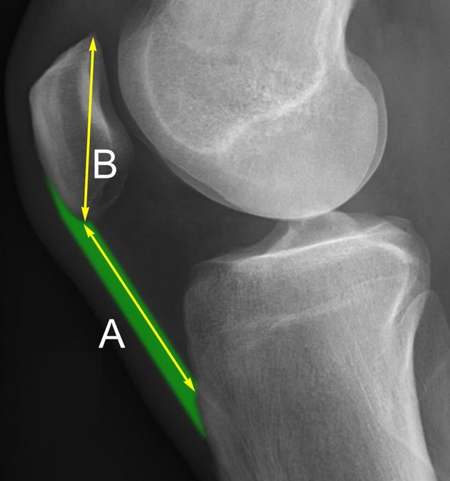

# Insall–Salvati ratio
Region: Knee
Keywords: patella alta, patella baja, patellar height, altura rotuliana, índice de Insall-Salvati

Height of the patella on a lateral knee radiograph in about 30° of flexion (also sagittal MRI).

## How to measure

- A: length of the patellar tendon, from the lower pole of the patella to its insertion on the tibial tuberosity (posterior surface).
- B: greatest diagonal length of the patella.
- Ratio = A / B.

## Values

| Finding | Ratio |
|---|---|
| Patella baja | < 0.8 |
| Normal | 0.8–1.2 |
| Patella alta | > 1.2 |

On sagittal MRI the limits are slightly higher (about 0.74–1.5).

## Source

Insall J, Salvati E. Patella position in the normal knee joint. Radiology 1971;101:101–104.

Picture: "Insall-Salvati ratio of patella baja.jpg" by Mikael Häggström, CC0 1.0, https://commons.wikimedia.org/wiki/File:Insall-Salvati_ratio_of_patella_baja.jpg (resized).
