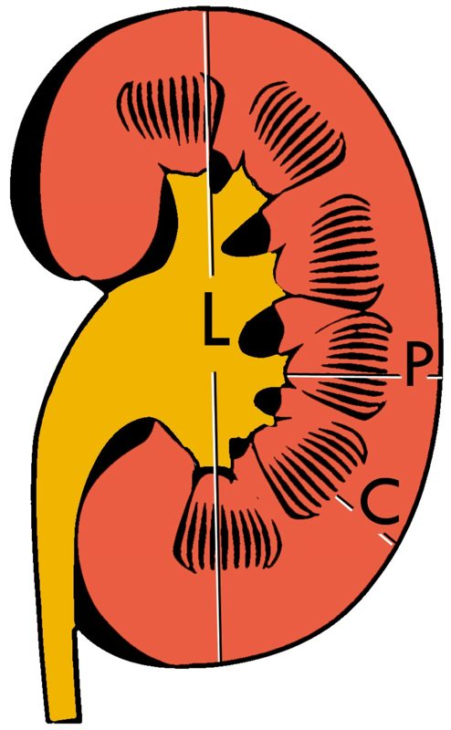

# Kidney length, parenchymal and cortical thickness
Region: Abdomen
Keywords: renal size, renal length, chronic kidney disease, atrophy, tamaño renal, riñón

Size of the kidney on ultrasound in its longest longitudinal section.

## How to measure

- L, length: pole to pole in the plane that shows the greatest length.
- P, parenchymal thickness: outer renal border to the renal sinus fat.
- C, cortical thickness: outer renal border to the base of a medullary pyramid.

## Values

| Measurement | Adult |
|---|---|
| Length | 10–12 cm (range about 9–13 cm) |
| Difference between sides | < 2 cm |
| Parenchymal thickness | 15–20 mm |
| Cortical thickness | 7–10 mm |

Small kidneys with a thin, bright cortex point to chronic disease. Length follows body height and falls with age.

## Source

Emamian SA et al. Kidney dimensions at sonography: correlation with age, sex, and habitus in 665 adult volunteers. AJR 1993;160:83–86. Hansen KL et al. Ultrasonography of the kidney: a pictorial review. Diagnostics 2016;6:2.

Picture: "Measures of the kidney.jpg" by Kristoffer Lindskov Hansen, Michael Bachmann Nielsen and Caroline Ewertsen, CC BY 4.0, https://commons.wikimedia.org/wiki/File:Measures_of_the_kidney.jpg (resized).
