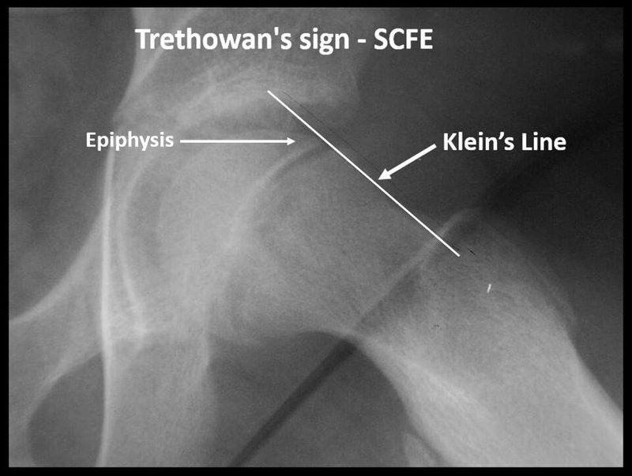

# Klein line
Region: Hip
Keywords: SCFE, slipped capital femoral epiphysis, Trethowan sign, epifisiolisis, coxa vara del adolescente

Screening line for slipped capital femoral epiphysis on an AP radiograph of the hip.

## How to measure

- Draw a line along the superior (lateral) border of the femoral neck and extend it past the physis.
- Compare with the other side. A frog-leg lateral view is more sensitive than the AP view.

## Values

| Finding | Meaning |
|---|---|
| The line crosses the lateral part of the epiphysis | Normal |
| The line misses the epiphysis (Trethowan sign) | Slipped capital femoral epiphysis |
| Width of epiphysis lateral to the line differs ≥ 2 mm between sides | Slip (modified Klein line, more sensitive) |

## Source

Klein A et al. Slipped capital femoral epiphysis. J Bone Joint Surg Am 1952;34:233–239. Green DW et al. A modification of Klein's line. J Pediatr Orthop 2009;29:449–453.

Picture: "Trethowan's sign seen in SCFE.jpg" by Dr.Vijaya chandar, CC0 1.0, https://commons.wikimedia.org/wiki/File:Trethowan's_sign_seen_in_SCFE.jpg (resized).
