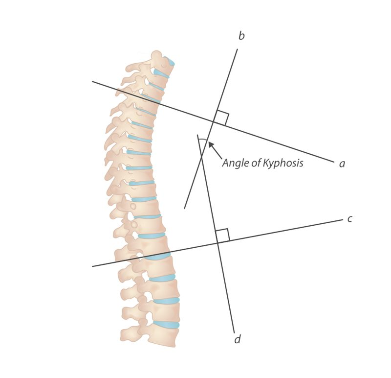

# Kyphosis angle (sagittal Cobb)
Region: Spine
Keywords: thoracic kyphosis, hyperkyphosis, Scheuermann, cifosis

Sagittal curvature of the thoracic spine by the Cobb method on a standing lateral radiograph.

## How to measure

- Draw a line along the upper end plate of the upper vertebra of the curve (commonly T4 or T5) and one along the lower end plate of the lower vertebra (commonly T12).
- The angle between the lines, or between their perpendiculars, is the kyphosis angle.
- State the levels used: the value depends on them.

## Values

| Finding | Angle T4/T5–T12 |
|---|---|
| Usual range | about 20–40° |
| Hyperkyphosis | > 40–50° (definitions vary) |

Scheuermann disease (Sørensen): anterior wedging ≥ 5° of three or more adjacent vertebrae.

## Source

Fon GT, Pitt MJ, Thies AC. Thoracic kyphosis: range in normal subjects. AJR 1980;134:979–983. Sørensen KH, Scheuermann's juvenile kyphosis, 1964.

Picture: "Measurement of kyphosis.svg" by InjuryMap, CC BY-SA 4.0, https://commons.wikimedia.org/wiki/File:Measurement_of_kyphosis.svg (resized).
