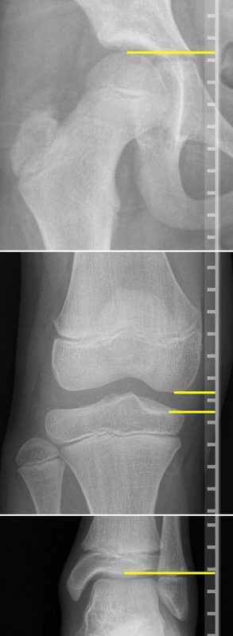

# Leg length measurement
Region: Lower limb
Keywords: leg length discrepancy, LLD, scanogram, orthoroentgenogram, dismetría, longitud de miembros inferiores

Length of femur and tibia and their difference between sides, on a scanogram, a standing full-length radiograph or a CT scout view.

## How to measure

- Femur: top of the femoral head to the distal surface of the medial femoral condyle.
- Tibia: medial tibial plateau to the tibial plafond.
- Whole limb: top of the femoral head to the middle of the tibial plafond.
- Compare sides; with a ruler in the field read the levels on the ruler.

## Values

| Difference | Meaning |
|---|---|
| < 10 mm | Common in the general population, usually without consequence |
| 10–20 mm | Mild discrepancy |
| > 20 mm | Usually clinically relevant |

Knee or hip flexion contracture shortens the limb on the image.

## Source

Sabharwal S, Kumar A. Methods for assessing leg length discrepancy. Clin Orthop Relat Res 2008;466:2910–2922.

Picture: "Leg length measurement on X-ray.jpg" by Mikael Häggström, CC0 1.0, https://commons.wikimedia.org/wiki/File:Leg_length_measurement_on_X-ray.jpg (resized).
