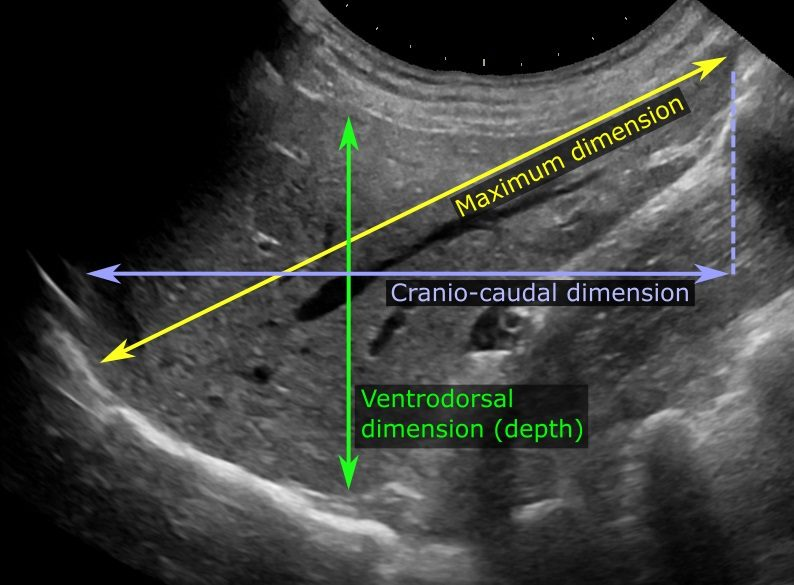

# Liver span (midclavicular line)
Region: Abdomen
Keywords: hepatomegaly, liver size, right lobe, hepatomegalia, hígado

Size of the right lobe of the liver on a sagittal ultrasound image in the midclavicular line.

## How to measure

- Sagittal plane through the right lobe in the midclavicular line, in quiet inspiration.
- Craniocaudal dimension: from the dome under the diaphragm to the lower edge. The greatest oblique dimension is somewhat larger: say which one was measured.

## Values

| Finding | Craniocaudal dimension in adults |
|---|---|
| Normal | < 16 cm (average about 14 cm) |
| Hepatomegaly | > 16 cm |

A Riedel lobe makes a normal liver look long; size follows body height and body mass index.

## Source

Kratzer W et al. Factors affecting liver size: a sonographic survey of 2080 subjects. J Ultrasound Med 2003;22:1155–1161.

Picture: "Liver measurements on ultrasonography.jpg" by Mikael Häggström, CC0 1.0, https://commons.wikimedia.org/wiki/File:Liver_measurements_on_ultrasonography.jpg (resized).
