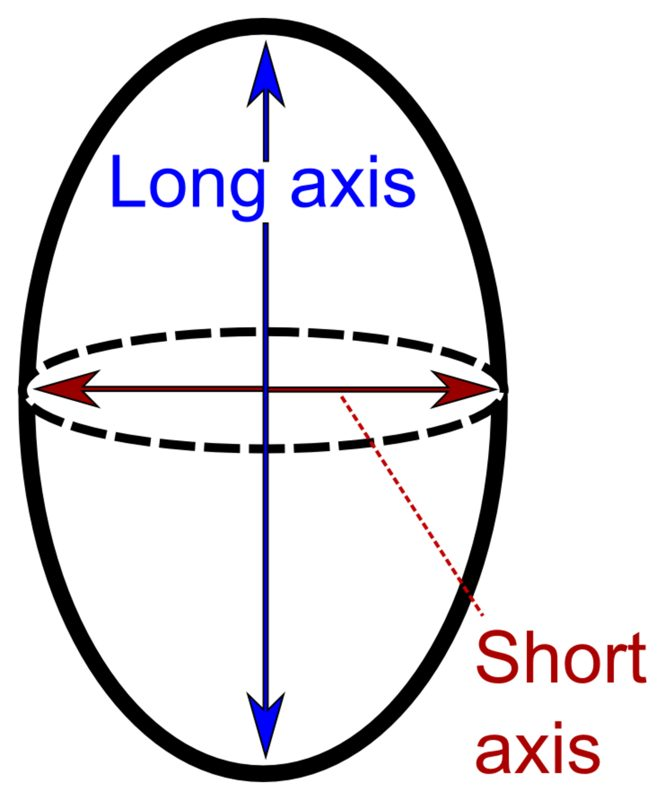

# Lymph node short-axis diameter
Region: Oncology
Keywords: lymphadenopathy, node size, short axis, adenopatía, ganglio linfático

Size of a lymph node on axial CT or MRI.

## How to measure

- Find the longest diameter of the node in the axial plane.
- The short axis is the greatest diameter perpendicular to it. It varies less with the orientation of the node than the long axis.

## Values

Usual upper limits of the short axis:

| Site | Upper limit |
|---|---|
| Most sites (neck, mediastinum, abdomen) | 10 mm |
| Jugulodigastric node | 11 mm |
| Retrocrural | 6 mm |
| Pelvis | 8–10 mm |
| Inguinal | 15 mm |

Size alone is a weak criterion: small nodes can hold tumour and large ones can be reactive. Shape, fatty hilum, necrosis and enhancement count as well.

## Source

Dorfman RE et al. Upper abdominal lymph nodes: criteria for normal size determined with CT. Radiology 1991;180:319–322. van den Brekel MW et al. Cervical lymph node metastasis: assessment of radiologic criteria. Radiology 1990;177:379–384.

Picture: "Long and short axis.png" by Mikael Häggström, CC0 1.0, https://commons.wikimedia.org/wiki/File:Long_and_short_axis.png (resized).
