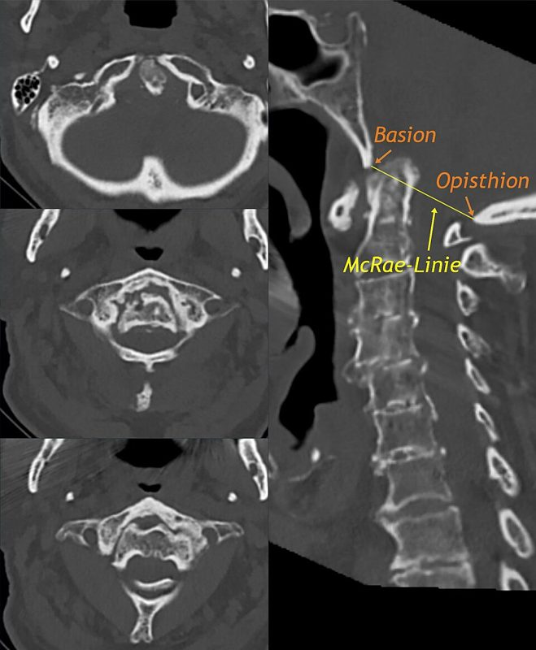

# McRae line
Region: Spine
Keywords: basilar invagination, basilar impression, foramen magnum, basion, opisthion, craniocervical junction, impresión basilar

Line across the foramen magnum that the dens must not cross; midsagittal CT or MRI, or a lateral radiograph.

## How to measure

- Join the basion (anterior margin of the foramen magnum) and the opisthion (posterior margin).
- See where the tip of the dens lies relative to the line.

## Values

| Finding | Meaning |
|---|---|
| Tip of the dens below the line (about 5 mm on average) | Normal |
| Tip of the dens at or above the line | Basilar invagination |

The line is also the reference for cerebellar tonsil position on MRI (see Chiari measurements in other references).

## Source

McRae DL, Barnum AS. Occipitalization of the atlas. AJR 1953;70:23–46.

Picture: "Basilaere Impression als Zufallsbefund 88W - CT axial und sagittal - 001 - Annotation.jpg" by Hellerhoff, CC BY-SA 4.0, https://commons.wikimedia.org/wiki/File:Basilaere_Impression_als_Zufallsbefund_88W_-_CT_axial_und_sagittal_-_001_-_Annotation.jpg (resized).
