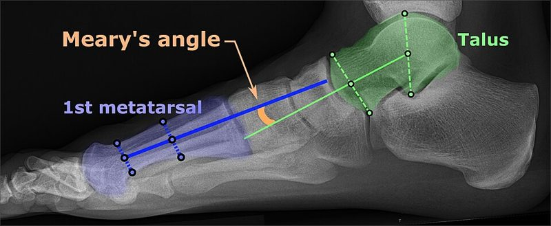

# Meary's angle (talus–first metatarsal angle)
Region: Foot and ankle
Keywords: talo-first metatarsal, pes planus, flatfoot, pes cavus, pie plano, pie cavo, ángulo de Meary

Alignment of the medial column of the foot on a weight-bearing lateral radiograph.

## How to measure

- Draw the long axis of the talus (through the middle of its body and neck).
- Draw the long axis of the first metatarsal.
- Meary's angle is the angle between them.

## Values

| Finding | Angle |
|---|---|
| Normal | 0° ± 4° (the axes are almost one line) |
| Pes planus | > 4°, apex plantar (mild < 15°, moderate 15–30°, severe > 30°) |
| Pes cavus | > 4°, apex dorsal |

## Source

Meary R. Le pied creux essentiel. Rev Chir Orthop 1967;53:389–410. Younger AS et al. Foot Ankle Int 2005;26:820–825.

Picture: "Talar-1st metatarsal angle (Meary's angle).jpg" by Mikael Häggström, CC0 1.0, https://commons.wikimedia.org/wiki/File:Talar-1st_metatarsal_angle_(Meary's_angle).jpg (resized).
