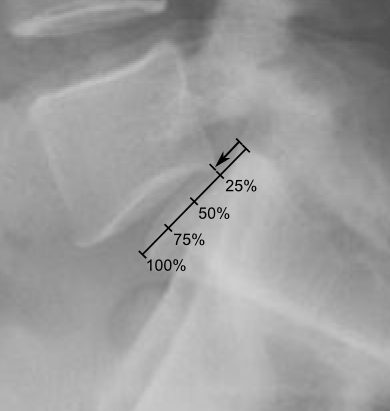

# Spondylolisthesis grading (Meyerding)
Region: Spine
Keywords: slip, anterolisthesis, spondyloptosis, listesis, espondilolistesis

Forward slip of a vertebra over the one below as a fraction of the lower end plate, on a lateral radiograph.

## How to measure

- Divide the upper end plate of the lower vertebra (often S1) into four equal parts.
- The grade is the quarter in which the posteroinferior corner of the upper vertebra lies.
- As a percentage: slip distance divided by the length of the lower end plate, times 100.

## Values

| Grade | Slip |
|---|---|
| I | < 25 % |
| II | 25–50 % |
| III | 50–75 % |
| IV | 75–100 % |
| V (spondyloptosis) | > 100 % |

## Source

Meyerding HW. Spondylolisthesis. Surg Gynecol Obstet 1932;54:371–377.

Picture: "Spondylolisthesis measurement on X-ray.png" by Chester J Donnally III (StatPearls); annotated by Mikael Häggström, CC BY 4.0, https://commons.wikimedia.org/wiki/File:Spondylolisthesis_measurement_on_X-ray.png (resized).
