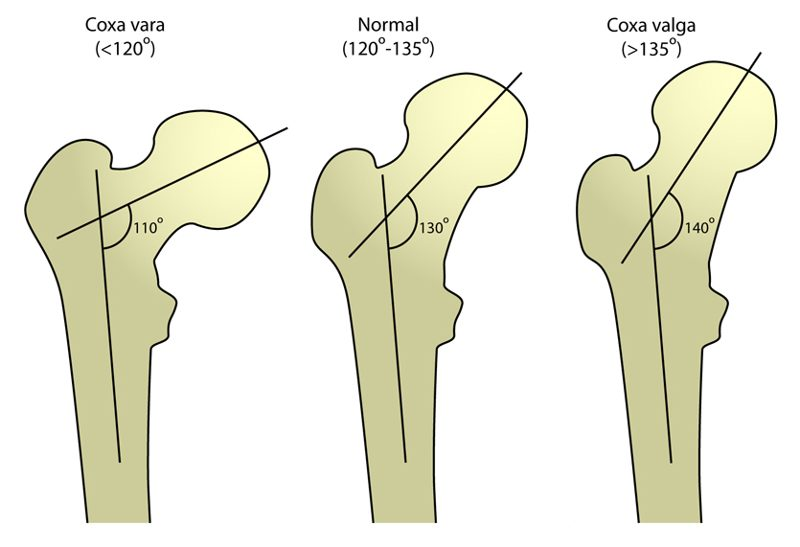

# Femoral neck–shaft angle
Region: Hip
Keywords: CCD angle, caput-collum-diaphyseal, cervicodiaphyseal, coxa vara, coxa valga, ángulo cervicodiafisario

Angle between the femoral neck and the shaft, on an AP radiograph with the hip in 15–20° of internal rotation.

## How to measure

- Draw the axis of the femoral shaft.
- Draw the axis of the neck through the centre of the femoral head and the middle of the neck.
- Measure the medial angle between them.

## Values

| Finding | Angle |
|---|---|
| Coxa vara | < 120° |
| Normal adult | 120–135° |
| Coxa valga | > 135° |

The angle is about 150° at birth and falls with growth. External rotation of the hip makes it look larger.

## Source

Tönnis D. Clin Orthop 1976;119:39–47. Standard orthopaedic texts.

Picture: "FemurAngles.jpg" by Behrang Amini, CC BY 2.5 / CC BY-SA 3.0 / GFDL 1.2+, https://commons.wikimedia.org/wiki/File:FemurAngles.jpg (resized).
