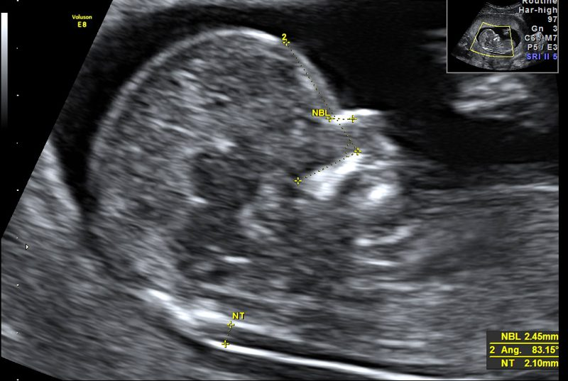

# Nuchal translucency
Region: Obstetrics
Keywords: NT, first trimester screening, aneuploidy, trisomy 21, translucencia nucal, cribado

Fluid under the skin of the fetal neck at 11 to 13 weeks 6 days (crown–rump length 45–84 mm).

## How to measure

- Midsagittal image of the fetus in a neutral position, magnified so that the head and upper chest fill the screen.
- Tell the fetal skin from the amnion.
- Place the calipers on the inner borders of the two white lines, at the widest part of the translucency, perpendicular to the fetus.
- Take the largest of several good measurements.

## Values

| Finding | NT |
|---|---|
| 95th centile | from about 2.1 mm at CRL 45 mm to 2.7 mm at CRL 84 mm |
| 99th centile | 3.5 mm at any CRL |
| ≥ 3.5 mm | Raised: risk of aneuploidy, cardiac defects and genetic syndromes |

The risk is calculated from NT together with maternal age, CRL and serum markers.

## Source

Snijders RJ et al. UK multicentre project on assessment of risk of trisomy 21 by maternal age and fetal nuchal-translucency thickness at 10–14 weeks of gestation. Lancet 1998;352:343–346. Fetal Medicine Foundation criteria.

Picture: "Nuchal translucency Dr. Wolfgang Moroder.jpg" by Wolfgang Moroder, CC BY-SA 3.0 / GFDL, https://commons.wikimedia.org/wiki/File:Nuchal_translucency_Dr._Wolfgang_Moroder.jpg (header cropped, resized).
